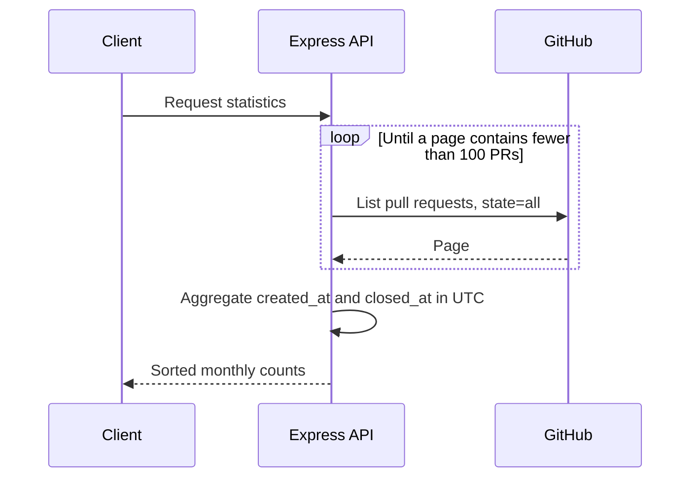

# Downshift pull-request statistics API

A small Express service that reads pull requests from the fixed `downshift-js/downshift` GitHub repository and summarizes opened and closed events by calendar month. It is an API integration exercise, not a general repository analyzer or a cached analytics platform.

## Run

Use Node 22. All development tools are local dependencies; no global install or `sudo` is needed.

```sh
npm ci --ignore-scripts
cp .env.example .env
npm run build
npm start
```

The server listens at `http://127.0.0.1:3000`. Use `npm run dev` for local reloads. `PORT` defaults to `3000`; `API_VERSION` defaults to `/api/v1`. Interactive documentation is at `/api/v1/api-docs`.

`GITHUB_PERSONAL_ACCESS_TOKEN` is optional and stays server-side. Public pull-request listing can be unauthenticated; see [GitHub's endpoint permissions](https://docs.github.com/en/rest/pulls/pulls#list-pull-requests). Do not grant broad repository-write scopes just to read this public dataset. Rate limits may prevent a full retrieval without suitable authentication.

## Requests and meaning

```sh
curl http://127.0.0.1:3000/api/v1/repo/stats
curl 'http://127.0.0.1:3000/api/v1/repo/stats/summary?month=9&year=2021'
curl 'http://127.0.0.1:3000/api/v1/repo/stats/year-summary?year=2021'
```

A synthetic two-PR fixture produces this all-month response:

```json
[
  {"month":"September 2021","opened":2,"closed":0},
  {"month":"October 2021","opened":0,"closed":1}
]
```

These are example counts, not measured Downshift activity. A PR opened in September and closed in October contributes to both months. Reopened events are not reconstructed; the current GitHub `closed_at` field determines the closing month. Month keys are grouped in UTC, sorted chronologically and labeled in English independently of the host locale. Months with no events are omitted.

| Route suffix under `/api/v1/repo/stats` | Response |
| --- | --- |
| `/` | All populated months |
| `/summary?month=1..12&year=YYYY` | One month; 404 if absent |
| `/year-summary?year=YYYY` | Populated months in that year; 404 if absent |

Invalid dates, repeated query values and missing parameters return 400. Upstream failures return a generic 502 without provider diagnostics.

## Design and checks



```sh
npm run build
npm test
```

Twelve offline tests cover pagination termination, monthly counts, query validation, missing data and upstream failure. GitHub is mocked, so tests need no account, token or network. Importing the app does not start a listener. The existing ts-jest release warns about TypeScript 5.0 compatibility; the build and these tests pass, but broader toolchain modernization has not been done.

Every request fetches the repository again and retains all PRs in memory. There is no cache, request deduplication, API authentication or rate limiting. Before hosting, add bounded upstream timeouts, shared caching, concurrency controls and an explicit refresh policy. A multi-page crawl is not a point-in-time snapshot while the upstream repository changes. No live GitHub statistics were requested during verification.
