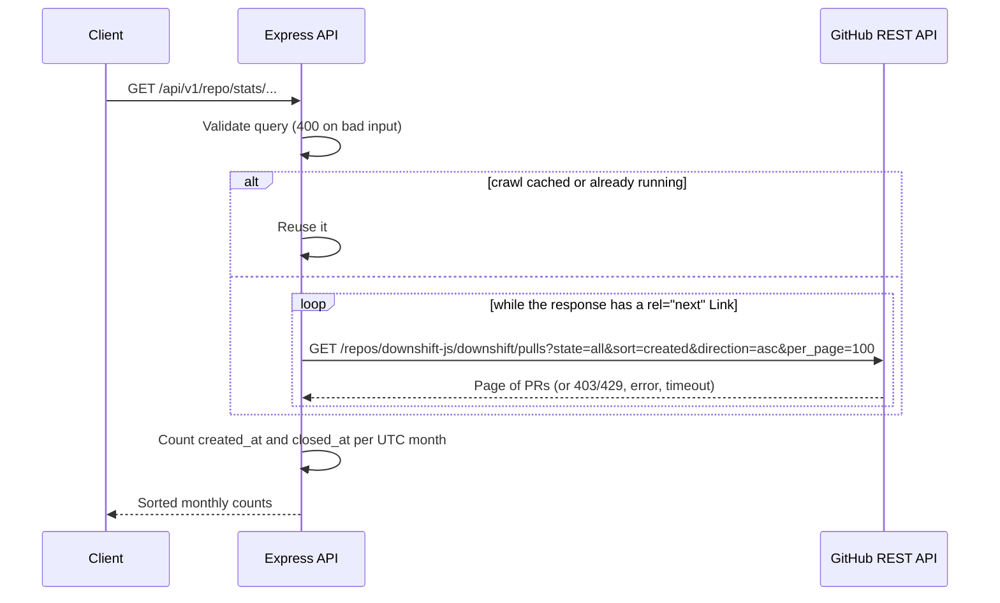

# github-api-service-kit

A small Express and TypeScript service that reads every pull request of the fixed `downshift-js/downshift` GitHub repository and reports how many were opened and closed in each calendar month (UTC).

Despite the package name, this is not a general-purpose GitHub toolkit. It answers one question about one repository and exists as a compact, tested example of consuming a paginated, rate-limited third-party API from a Node service: following `Link` pages, bounding upstream calls with timeouts, turning rate limits into honest `503`s and keeping the result cheap to ask for repeatedly.

## Quick start

Requires Node 22 (see `.nvmrc`). Nothing needs a global install.

```sh
npm ci --ignore-scripts
cp .env.example .env
npm run build
npm start
```

The server listens on `http://127.0.0.1:3000`; Swagger UI for the three routes is at `http://127.0.0.1:3000/api/v1/api-docs/`. `npm run dev` runs the TypeScript sources with `node --watch`.

With Docker instead (the image runs as the unprivileged `node` user and binds to `0.0.0.0`):

```sh
docker build -t github-api-service-kit .
docker run --rm -p 3000:3000 github-api-service-kit
```

## Configuration

All variables are optional. `npm start` and `npm run dev` read `.env` if it exists; variables already set in the environment win.

| Variable | Default | Purpose |
| --- | --- | --- |
| `PORT` | `3000` | Listening port |
| `HOST` | `127.0.0.1` | Interface to bind (`0.0.0.0` in the Docker image) |
| `API_VERSION` | `/api/v1` | Route prefix |
| `GITHUB_PERSONAL_ACCESS_TOKEN` | empty | Sent as a bearer token to raise GitHub's rate limit. Public PR listing works without it; a fine-grained token with no extra permissions is enough. It is never sent to any host other than `GITHUB_API_URL`. |
| `GITHUB_API_URL` | `https://api.github.com` | Base URL of the GitHub REST API; point it at the bundled fake for offline runs |
| `GITHUB_TIMEOUT_MS` | `10000` | Per-request timeout for GitHub calls |
| `CACHE_TTL_SECONDS` | `300` | How long a completed crawl is reused; `0` refetches on every request |

Without a token GitHub allows 60 requests an hour, and a full crawl of Downshift takes one request per 100 PRs, so the cache matters.

## Routes

| `GET /api/v1/repo/stats` ... | Returns |
| --- | --- |
| `/` | Every month that has at least one opened or closed PR |
| `/summary?month=1..12&year=YYYY` | That month, or `404` if nothing happened in it |
| `/year-summary?year=YYYY` | The populated months of that year, or `404` |

Missing, malformed or repeated parameters return `400` before GitHub is contacted. GitHub failures return `502`, a GitHub timeout `504`, and a GitHub rate limit `503` with a `Retry-After` header when GitHub says when it resets. Error bodies are always `{"error": "..."}` and never include upstream diagnostics.

### Example output

The numbers below are **not Downshift data**. They come from the fake GitHub server in `tests/support/fakeGithub.ts`, which serves 230 synthetic PRs over three pages, captured with the Docker image pointed at it:

```text
GET /api/v1/repo/stats/year-summary?year=2021  -> 200
[{"month":"September 2021","opened":24,"closed":7},{"month":"October 2021","opened":23,"closed":16},
 {"month":"November 2021","opened":23,"closed":18},{"month":"December 2021","opened":24,"closed":18}]

GET /api/v1/repo/stats/summary?month=10&year=2021  -> 200
{"month":"October 2021","opened":23,"closed":16}

GET /api/v1/repo/stats/summary?month=13&year=21  -> 400
{"error":"Invalid query: month must be 1-12, year must have four digits, each given once."}

GET /api/v1/repo/stats/summary?month=9  -> 400
{"error":"Query parameters required: month, year."}

GET /api/v1/repo/stats/summary?month=1&year=2020  -> 404
{"error":"No data found for the given month and year."}
```

To reproduce it without touching GitHub, start the fake in one terminal and the service in another:

```sh
npx ts-node -T tests/support/fakeGithub.ts          # Fake GitHub API at http://127.0.0.1:4010
GITHUB_API_URL=http://127.0.0.1:4010 npm start
curl 'http://127.0.0.1:3000/api/v1/repo/stats/summary?month=10&year=2021'
```

## How it works



- **Pagination** follows GitHub's `Link` header instead of guessing page numbers, so an exactly full last page costs no extra request. PRs are requested oldest first, so a PR opened during the crawl lands on the final page rather than shifting earlier ones, and results are de-duplicated by PR number.
- **Counting**: a PR opened in September and closed in October counts in both months. Reopen history is not reconstructed; GitHub's current `closed_at` decides the closing month. PRs with a missing or unparseable timestamp are skipped for that side. Month labels are English and independent of the host locale.
- **Caching**: concurrent requests share one in-flight crawl and a successful crawl is kept for `CACHE_TTL_SECONDS` in process memory. Failures are not cached.
- **HTTP client**: Node's built-in `fetch` with `AbortSignal.timeout`, so there is no SDK dependency.

## Development

```sh
npm run lint   # strict TypeScript check of src and tests
npm test       # Jest + supertest, fully offline
```

The 32 tests cover month bucketing, Link-header pagination, de-duplication, token scoping, timeouts, rate limits, input validation and the routes end to end. They talk to a local fake GitHub server or a mocked crawler; no test, example or check in this repository calls the real GitHub API or needs a token.

## Limitations

- One hard-coded repository; changing it means editing `REPO_PATH` in `src/controllers/RepoController.ts`.
- The whole PR list is held in memory and the cache is per process, so several replicas each crawl GitHub on their own.
- A multi-page crawl is not a point-in-time snapshot of a repository that is changing underneath it.
- There is no authentication or rate limiting on this API itself; put it behind something that provides them before exposing it publicly.

## License

MIT, see [LICENSE](LICENSE).
